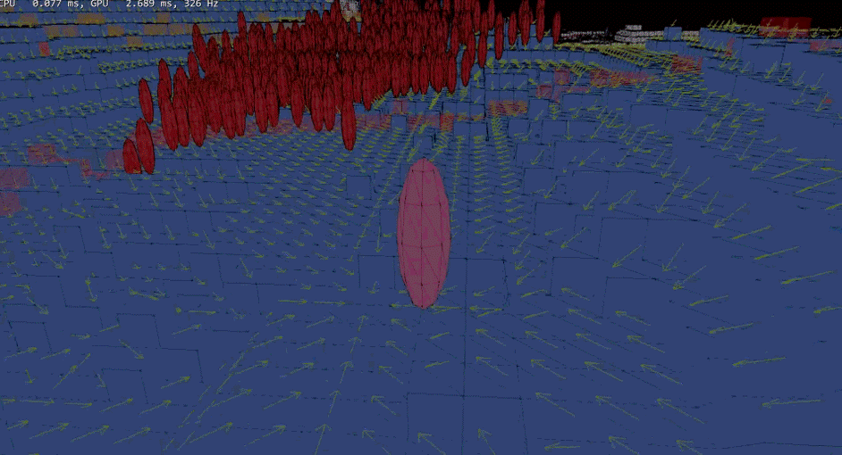

# Formation Flow Field

<p align="center">
  
</p>

Flow Field는 그리드의 모든 칸에 "목표로 가려면 어디로 가야 하는가"를 미리 계산해 두는 길찾기입니다. 개체는 자기가 선 칸의 방향만 읽으면 되므로, 몇 마리가 있든 탐색은 한 번입니다.

이 프로젝트는 그 Flow Field를 **평면 그리드가 아닌 3D 복셀 지형**에서 구현하고, **10,000마리 규모**로 동작시킵니다.

- 환경: C++14 / MiniEngine / DirectX 12
- 맵: 514 × 514 복셀 (HeightMap + 관통 터널 + 병목 협곡)
- 주차별 개발 일정은 [개발 계획.md](개발%20계획.md)

---

## 왜 필요한가

개체마다 A\*를 돌리면 **탐색 비용이 개체 수에 비례**합니다. 10,000체가 같은 목표를 쫓으면 탐색을 10,000번 해야 하고, 목표가 한 칸만 움직여도 전부 무효가 됩니다.

| | A\* | Flow Field |
|---|---|---|
| 탐색 방향 | 출발 → 목표 | 목표 → 전방향 |
| 산출물 | 경로 1개 | 모든 칸의 진행 방향 |
| 탐색 횟수 | 개체 수만큼 | **1회, 전 개체 공유** |
| 개체당 비용 | 재탐색 | **O(1) 조회** |

### 3D 복셀에서 생기는 문제

평면 그리드와 달리 복셀 지형은 **한 xz 좌표에 걸을 수 있는 면이 여러 층** 있습니다 (터널 위아래, 아치). 그래서 칸을 `(x, z)`가 아니라 `(x, y, z)`로 다뤄야 하고, 이웃 판정도 8방향에 **높이차**가 붙습니다.

또 하나는 규모입니다. 514 × 514 전체에 Dijkstra를 돌리면 비용이 맵 크기에 비례합니다. cost는 `목표까지의 거리`라는 **전역 의존값**이라 구역 단위로 건너뛰거나 쪼갤 수 없고, 줄이는 방법은 **탐색 공간 자체를 좁히는 것**뿐입니다.

---

## 어떻게 동작하는가

3단계로 나눠서, 마지막 Dijkstra가 맵 전체를 보지 않게 만듭니다.

```
[1] 청크 A*        출발 → 목표의 대략적인 통로를 먼저 찾는다
       ↓
[2] 회랑 마스크     그 통로 주변 칸만 BFS로 모은다
       ↓
[3] Dijkstra       마스크 안에서만 cost를 퍼뜨리고 방향을 계산한다
```

**A\*의 역할은 경로가 아니라 계산 범위입니다.** 실제 방향은 [3]이 전부 다시 계산하고, A\*가 뱉은 노드열은 마스크를 어디까지 펼칠지 정하는 씨앗으로만 쓰입니다. 결과적으로 연산량이 **맵 크기가 아니라 회랑 길이에 비례**합니다.

### [1] 노드는 청크가 아니라 청크 안의 연결 성분

청크(8 × 8)를 통째로 노드로 삼으면, 벽으로 갈라진 청크에서 **벽 너머로 경로가 이어집니다.** 그래서 청크 내부를 flood fill로 쪼개 성분마다 노드를 만들고, 성분 사이에는 간선을 두지 않습니다.

```
청크 하나가 벽으로 갈라진 경우

  ┌───────┐        노드 A ──── (간선 없음) ──── 노드 B
  │ A │ B │   →    A* 가 A에서 B로 건너가지 못한다
  └───┴───┘
```

### [2] 회랑 마스크

A\* 노드열의 각 노드에서 margin만큼 BFS로 퍼뜨려, 그 칸들의 집합을 만듭니다. margin은 그룹 인원수에 비례합니다 — 100명이 한 줄로 지나갈 수는 없으니까요.

### [3] Dijkstra + 방향 계산

```
openlist  ← goal 추가 (cost 0)

while openlist 비어있지 않음:
    node = openlist 중 cost 최소          # 변동 비용이 있으므로 최소부터
    cost[node] = node.cost

    for n in GetWalkableNeighbors(node):  # 8방향 + 높이차
        if n not in 마스크: continue      # ← 회랑 밖은 확장하지 않는다
        openlist 에 (n, node.cost + n.cost) 추가

# 방향 계산
for node in 마스크:
    cheapest = cost 가 가장 낮은 이웃
    direction[node] = cheapest - node     # (dx, dy, dz) 각 -1/0/1
```

방향은 `(dx, dy, dz)`를 **2비트씩 묶어 1바이트**로 저장합니다. 실수 벡터가 필요한 곳(화살표 시각화)만 조회 시점에 정규화합니다.

`GetWalkableNeighbors`는 **A\*와 Dijkstra가 반드시 공유**합니다. 각자 이웃 규칙을 구현하면 두 시스템이 서로 다른 그래프를 가정하게 됩니다.

### 재계산은 별도 스레드에서

목표(플레이어)가 움직이면 필드를 다시 만들어야 합니다. cost가 전역 의존값이라 **부분 갱신은 불가능**합니다 — 경계에서 옛 값과 새 값이 섞이면 경로가 끊깁니다.

대신 **낡은 필드는 그 자체로 자기 정합적**이라, 갱신이 늦어도 NPC가 잘못된 방향으로 가지는 않습니다. 이 성질을 근거로 전체 재빌드를 유지하되 **워커 스레드로 옮기고**, 메인 루프는 완성될 때까지 직전 필드를 그대로 씁니다.

```
메인    ── Submit ──┐              ┌── 결과 수령 (필드 통째 교체)
        (직전 필드로 계속 이동)     │
워커    ────────────└── Build ─────┘
```

이동 가능 여부는 필드가 아니라 **살아 있는 그리드**가 판단하므로, 지형이 바뀐 뒤 필드 재빌드를 미뤄도 NPC가 벽으로 걸어 들어가지 않습니다.

---

## 성능

| 항목 | 값 |
|---|---|
| 개체당 조회 비용 | **O(1)** — 자기 칸의 방향 1바이트 |
| 탐색 횟수 | 개체 수와 무관하게 **1회** |
| 이동 연산 | **0.04 ms / 틱** (1,000체 기준, 프레임 예산의 0.24%) |
| 필드 재계산 | 워커 스레드 — **메인 루프 영향 없음** |
| 연산량 증가 기준 | 맵 크기가 아닌 **회랑 길이** |

추격하지 않는 NPC는 필드를 아예 조회하지 않고(배회는 지역 이동), 플레이어에서 먼 그룹은 순회 대상에서 제외됩니다.


---

## 조작

| 키 | 동작 |
|---|---|
| `Tab` | 카메라 조작 ↔ 마우스 피킹 전환 |
| `1` / `2` / `3` | 그룹 이동 / 지형 생성 / 플레이어 추격(3인칭) |
| `4` | 조준 지점에 화염 자극 → 주변 NPC 도주 |
| `F1` ~ `F4` | 와이어프레임 / 청크 색상 / **방향 화살표** / 어그로 반경 |

`F3`을 켜면 회랑 안쪽에만 방향이 계산된 모습이 보입니다.


## 참고

- [MiniEngine (DirectX-Graphics-Samples)](https://github.com/microsoft/DirectX-Graphics-Samples)
